# Mini Banking System — Entity-Relationship Diagram

All 17 tables and their 20 foreign keys, generated from `appserver/app/models/`. GitHub renders the diagram below; to export an image, paste the code block into <https://mermaid.live>.

**Key:** `PK` primary key · `FK` foreign key · `UK` unique (MySQL indexes these automatically).
**Lines:** `||` exactly one · `|o` zero or one · `o{` zero or many · `o|` zero or one (per parent row).

| Layer | Tables |
|---|---|
| 1. Reference data | `roles`, `account_types`, `banks`, `fee_types` |
| 2. Users & security | `users`, `sessions`, `audit_logs` |
| 3. Account configuration | `accounts`, `withdrawal_limits`, `interest_policies` |
| 4. Transactions | `deposits`, `withdrawals`, `transfers`, `interbank_transfers` |
| 5. Charges, interest & ledger | `fee_records`, `interest_records`, `ledger_entries` |

```mermaid
erDiagram
    account_types {
        bigint id PK
        varchar type_code UK
        varchar type_name
        decimal minimum_balance
        decimal opening_deposit
        decimal annual_interest_rate
        decimal daily_withdrawal_limit
        timestamp created_at
    }
    banks {
        bigint id PK
        varchar bank_code UK
        varchar swift_code
        varchar bank_name
        varchar short_name
        varchar api_endpoint
        varchar contact_email
        enum status
        timestamp created_at
    }
    fee_types {
        bigint id PK
        varchar fee_code UK
        varchar fee_name
        text fee_description
        decimal fixed_amount
        decimal percentage_rate
        timestamp created_at
    }
    roles {
        bigint id PK
        varchar role_code UK
        varchar role_name
        text description
        timestamp created_at
    }
    interest_policies {
        bigint id PK
        bigint account_type_id FK
        varchar policy_name
        decimal annual_rate
        enum compounding_frequency
        date effective_date
        date expiration_date
    }
    users {
        bigint id PK
        varchar username UK
        varchar hashed_password
        varchar email UK
        varchar mobile_number
        varchar first_name
        varchar middle_name
        varchar last_name
        date date_of_birth
        bigint role_id FK
        enum account_status
        datetime last_login_at
        timestamp created_at
        timestamp updated_at
    }
    accounts {
        bigint id PK
        varchar account_number UK
        bigint customer_id FK
        bigint account_type_id FK
        decimal available_balance
        decimal ledger_balance
        varchar currency_code
        enum status
        timestamp opened_at
        datetime closed_at
        varchar branch_code
    }
    audit_logs {
        bigint id PK
        bigint user_id FK
        varchar action_type
        varchar entity_name
        bigint entity_id
        json old_value
        json new_value
        varchar ip_address
        text user_agent
        timestamp action_timestamp
    }
    sessions {
        bigint id PK
        bigint user_id FK
        text jwt_token
        text refresh_token
        varchar ip_address
        text user_agent
        timestamp login_at
        datetime expires_at
        datetime revoked_at
    }
    deposits {
        bigint id PK
        bigint account_id FK
        varchar reference_number UK
        decimal amount
        enum deposit_channel
        bigint deposited_by_user_id FK
        text remarks
        datetime transaction_date
        timestamp created_at
    }
    fee_records {
        bigint id PK
        bigint account_id FK
        bigint fee_type_id FK
        varchar transaction_reference
        decimal amount_charged
        timestamp charged_at
        text remarks
    }
    interbank_transfers {
        bigint id PK
        bigint source_account_id FK
        bigint target_bank_id FK
        varchar target_account_number
        varchar beneficiary_name
        varchar reference_number UK
        decimal amount
        decimal transfer_fee
        enum status
        timestamp initiated_at
        datetime completed_at
    }
    interest_records {
        bigint id PK
        bigint account_id FK
        bigint policy_id FK
        decimal amount_credited
        decimal balance_before
        decimal balance_after
        timestamp credited_at
    }
    ledger_entries {
        bigint id PK
        bigint account_id FK
        varchar transaction_reference
        enum transaction_type
        decimal debit_amount
        decimal credit_amount
        decimal balance_after
        datetime transaction_date
        timestamp created_at
    }
    transfers {
        bigint id PK
        bigint source_account_id FK
        bigint destination_account_id FK
        varchar transfer_reference UK
        decimal amount
        enum transfer_type
        text remarks
        enum status
        timestamp created_at
        datetime completed_at
    }
    withdrawal_limits {
        bigint id PK
        bigint account_id FK,UK
        decimal daily_limit_amount
        decimal daily_used_amount
        date last_reset_date
        timestamp updated_at
    }
    withdrawals {
        bigint id PK
        bigint account_id FK
        varchar reference_number UK
        decimal amount
        enum withdrawal_channel
        bigint approved_by_user_id FK
        text remarks
        datetime transaction_date
        timestamp created_at
    }
    account_types ||--o{ interest_policies : "account_type_id"
    roles ||--o{ users : "role_id"
    account_types ||--o{ accounts : "account_type_id"
    users ||--o{ accounts : "customer_id"
    users |o--o{ audit_logs : "user_id"
    users ||--o{ sessions : "user_id"
    accounts ||--o{ deposits : "account_id"
    users |o--o{ deposits : "deposited_by_user_id"
    accounts ||--o{ fee_records : "account_id"
    fee_types ||--o{ fee_records : "fee_type_id"
    accounts ||--o{ interbank_transfers : "source_account_id"
    banks ||--o{ interbank_transfers : "target_bank_id"
    accounts ||--o{ interest_records : "account_id"
    interest_policies ||--o{ interest_records : "policy_id"
    accounts ||--o{ ledger_entries : "account_id"
    accounts ||--o{ transfers : "destination_account_id"
    accounts ||--o{ transfers : "source_account_id"
    accounts ||--o| withdrawal_limits : "account_id"
    accounts ||--o{ withdrawals : "account_id"
    users |o--o{ withdrawals : "approved_by_user_id"
```

## Notes

- `transfers` points at `accounts` twice: `source_account_id` (money out) and `destination_account_id` (money in).
- `interbank_transfers` has no destination account in this database; the receiving account lives at the other bank, so it is stored as plain text in `target_account_number`.
- `withdrawal_limits.account_id` is unique, so each account has at most one limit row.
- `audit_logs.user_id`, `deposits.deposited_by_user_id` and `withdrawals.approved_by_user_id` are optional (nullable), so those rows can exist without a linked user.
- `ledger_entries.transaction_reference` and `fee_records.transaction_reference` are plain text, not foreign keys; they hold the reference number of the deposit, withdrawal or transfer they belong to.
